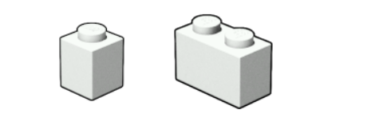
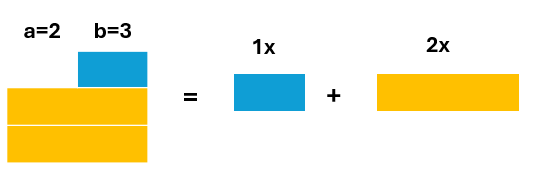
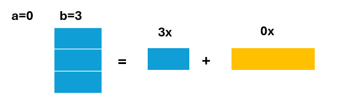

# Lego Tower

Uil is building a lego tower by stacking 1x1x2 and 1x1x2 lego bricks (see picture below). The tower has depth of 1, width of 2, and a height of `a b`, where `a` is the height of the left side of the tower and `b` is the right side of the tower (see pictures under the samples).
Using the minimum number of lego blocks: what is the number of 1x1 blocks and 2x2 lego blocks Uil needs?



## Input
One line with two integers, `a b` (separated by space)

## Output
One line with two integers, `x y` (separated by space); where `x` is the number of 1x1 blocks and `y` is the number of 1x2 blocks


Hint: in C++, `min(one number, another number)` returns the minimum of two numbers. Similarly, `max(one number, another numer)` will give the maximum of two numbers. 

For example,
```cpp
    int k = max(1, 3);
    cout << k; // output: 3
```
Or,

```cpp
    int num1 = -3;
    int num2 = 300;
    int smaller_number = min(num1, num2);
    cout << smaller_number; // output: -3
```

## Sample
### Sample Input 1
`2 3`

### Sample Output 1
`1 2`

#### Sample 1 Explanation


Uil wants to make a tower with left side height 2 and right side height 3. The minimum blocks uil needs is 3, with one 1x1x1 block (in blue) and two 1x1x2 blocks (in yellow).

### Sample Input 2
`0 3`

### Sample Output 2
`3 0`

#### Sample 2 Explanation
