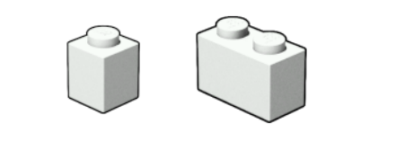
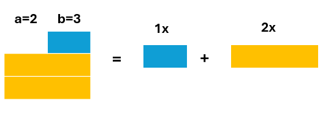
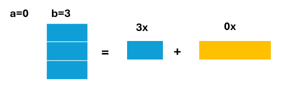

## Lego-toren

Uil bouwt een legotoren met behulp van 1×1×1- en 1×1×2-legoblokjes (zie afbeelding hieronder). 



De toren heeft een diepte van 1, een breedte van 2 en een hoogte van `a b`, waarbij `a` de hoogte van de linkerkant van de toren is en `b` de hoogte van de rechterkant (zie de afbeeldingen bij de voorbeelden).

Met zo weinig mogelijk legoblokjes: hoeveel 1×1×1-blokjes en hoeveel 1×1×2-blokjes heeft Uil nodig?

## Invoer

Eén regel met twee gehele getallen, `a b` (gescheiden door een spatie).

## Uitvoer

Eén regel met twee gehele getallen, `x y` (gescheiden door een spatie), waarbij:

* `x` het aantal 1×1×1-blokjes is;
* `y` het aantal 1×1×2-blokjes is.

## Programeer Hint

In C++ geeft `min(getal1, getal2)` het kleinste van twee getallen terug. Op dezelfde manier geeft `max(getal1, getal2)` het grootste van twee getallen terug.

Bijvoorbeeld:

```cpp
int k = max(1, 3);
cout << k; // uitvoer: 3
```

Of:

```cpp
int getal1 = -3;
int getal2 = 300;
int kleinste_getal = min(getal1, getal2);
cout << kleinste_getal; // uitvoer: -3
```

## Voorbeeld 1

### Invoer 1

```
2 3
```

### Uitvoer 1

```
1 2
```

### Uitleg 1


Uil wil een toren bouwen met een linkerhoogte van 2 en een rechterhoogte van 3. Het minimale aantal benodigde blokjes is 3: één 1×1×1-blokje (blauw) en twee 1×1×2-blokjes (geel).

## Voorbeeld 2

### Invoer 2

```
0 3
```

### Uitvoer 2

```
3 0
```

### Uitleg 2


De linkerkant van de toren heeft hoogte 0 en de rechterkant hoogte 3. Daarom zijn drie 1×1×1-blokjes nodig en geen enkel 1×1×2-blokje.
