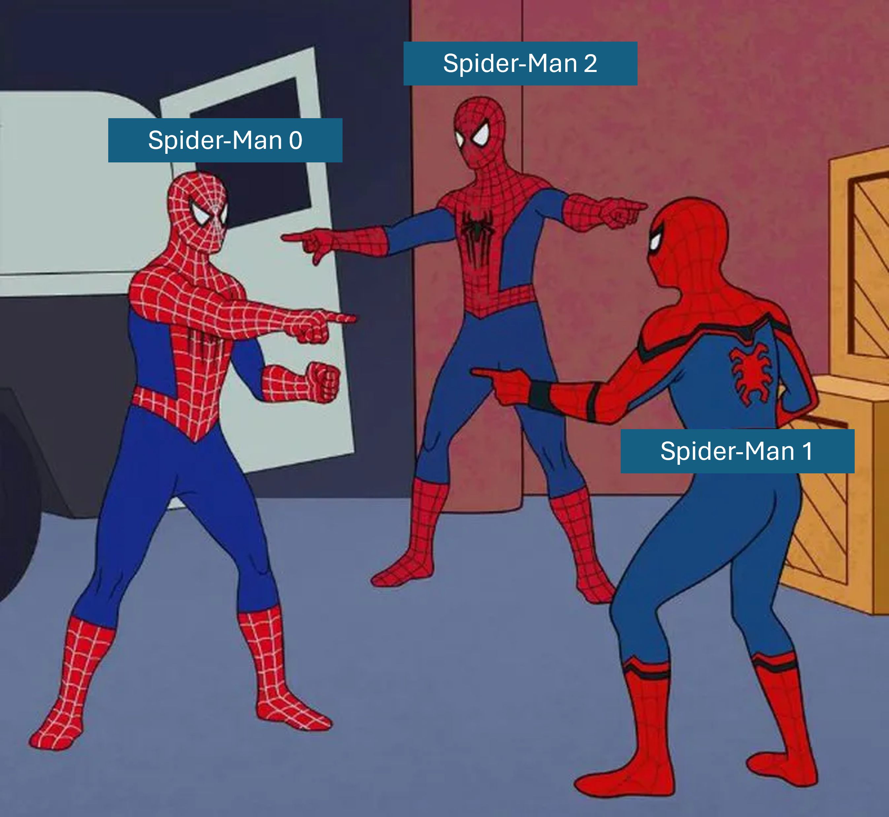

# Spider-Man

Uil and Giraf want to watch the newest Spider-Man movie, *Spider-Man: Brand New Day*. When they arrived at the cinema, they heard a lot of excited screams: turns out the real Spider-Man is also at the cinema today! Being very big fans of Spider-Man, Uil and Giraf runs into the crowd of people in hopes to get an autograph with Spider-Man. 

Unfortunately, there are too many people wearing a spider-man suit so nobody knows who the real Spider-Man is!
Specifically, there are `n` people dressed as spiderman standing in a circle, and each spider-man has their own number. The spider-man in the circle stand in order, where the left of each person is the spider-man with index one less, and the spider-man on their right has index one higher. 
Spider-man `0` is on the right of person `n-1`.



Interestingly, you notice every spiderman have a number of pieces of cobweb stuck to their suit, as if someone sprayed them with cobwebs. Formally, Spider-Man number `i` has `k_i` pieces of cobweb stuck to their suit. Since only the real Spider-Man can spray cobwebs, you know the spider-men directly on the left and right of the real Spider-Man must be sprayed with the most cobwebs!

Given `n`, and the number of pieces of cobweb on each spider-man, output the index of the real Spider-Man (i.e. the spider-man whose left- and right- neighbours together add up to the largest number of total cobwebs). It is guaranteed there is only one real Spider-Man (i.e. only one person with the maximum neighbour cobweb sum).

## Input
```
n
k0 k1 k2 ... k(n-1)
```

- One line with `n`, the number of people; `3 <= n <= 10^5` and `n ≠ 4` 
- One line with n integers, the number of pieces of cobwebs on each person; `1 <= ki <= 10^4`

## Output
One number with the index of the real Spider-Man. 
Note that index starts counting from `0` to `n-1`!

## Samples
### Sample Input 1
```
3
3 5 10 
```

### Sample Output 1
```
0
```

**Explanation:** 
- Spider-Man 0: their left neighbour has 10 cobweb (person 3), and their right neighbour has 5 cobwebs (person 1) => total = 15 cobwebs
- Spider-Man 1: their left neighbour has 3 cobwebs (person 0), and their right neighbour has 10 cobwebs (person 2) => total = 13 cobwebs
- Spider-Man 2: their left neighbour has 5 cobwebs (person 1), and their right neighbour has 3 cobwebs (person 0) => total = 8 cobwebs

Spider-Man 0 is the real Spider-Man!

