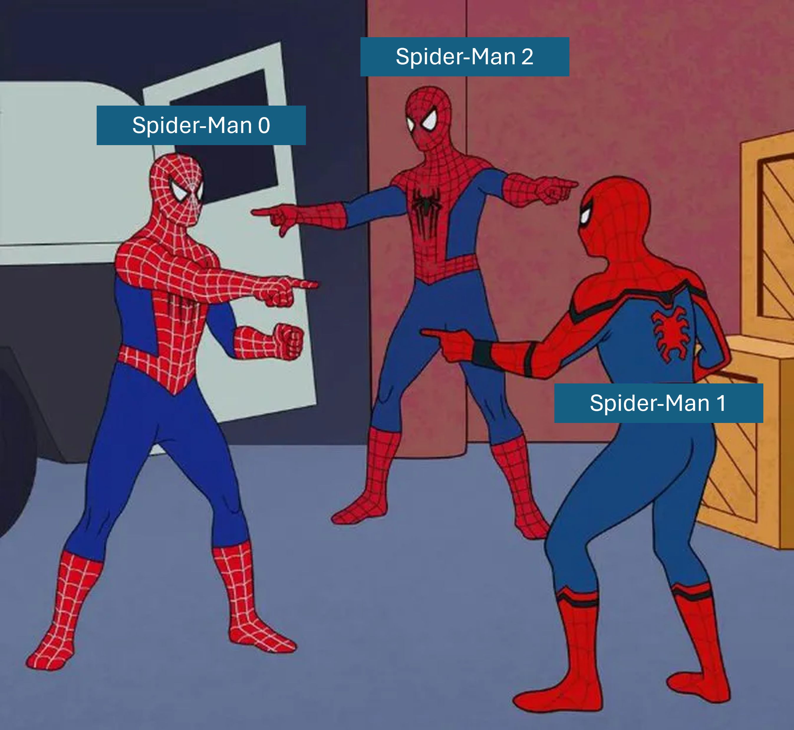

# Spider-Man

Uil en Giraf willen de nieuwste Spider-Man-film bekijken, *Spider-Man: Brand New Day*. Wanneer ze bij de bioscoop aankomen, horen ze overal enthousiaste kreten: de échte Spider-Man blijkt vandaag ook in de bioscoop te zijn! Als enorme Spider-Man-fans renden ze de menigte in om een ​​Spider-Man-handtekening te bemachtigen.

Helaas dragen er veel te veel mensen een Spider-Man-pak, waardoor niemand meer weet wie de echte Spider-Man is!

Er staan `n` mensen verkleed als Spider-Man in een cirkel, en iedere Spider-Man heeft een eigen nummer. Ze staan in oplopende volgorde: links van persoon `i` staat de Spider-Man met index één lager en rechts van persoon `i` staat de Spider-Man met index één hoger. Spider-Man `0` staat rechts van persoon `n-1`.



Opvallend genoeg zie je dat elke Spider-Man een aantal stukjes spinrag aan zijn pak heeft kleven, alsof iemand hem met spinrag heeft bespoten. Formeel heeft Spider-Man met index `i` precies `k_i` stukjes spinrag op zijn pak. Omdat alleen de échte Spider-Man spinrag kan afschieten, weet je dat de Spider-Mans direct links en rechts van de echte Spider-Man de meeste spinrag op zich hebben gekregen!

Gegeven `n` en het aantal stukjes spinrag op iedere Spider-Man, bepaal de index van de echte Spider-Man. Met andere woorden: zoek de Spider-Man waarvoor de som van het aantal stukjes spinrag van zijn linker- en rechterbuur het grootst is.

Er wordt gegarandeerd dat er precies één echte Spider-Man is; oftewel, er is precies één persoon met de maximale buur-som.

## Invoer

```text
n
k0 k1 k2 ... k(n-1)
```

- Eén regel met `n`, het aantal mensen; `3 <= n <= 10^5` en `n ≠ 4`.
- Eén regel met `n` gehele getallen, waarbij `k_i` het aantal stukjes spinrag op persoon `i` is; `1 <= k_i <= 10^4`.

## Uitvoer

Print één geheel getal: de index van de echte Spider-Man.

Let op: de indexering begint bij `0` en loopt tot en met `n-1`.

## Voorbeelden

### Voorbeeldinvoer 1

```text
3
3 5 10
```

### Voorbeelduitvoer 1

```text
0
```

### Uitleg

- **Spider-Man 0:** linkerbuur (persoon 2) heeft 10 stukjes spinrag  en rechterbuur (persoon 1) heeft 5 stukjes spinrag  → totaal = 15.
- **Spider-Man 1:** linkerbuur (persoon 0) heeft 3 stukjes spinrag  en rechterbuur (persoon 2) heeft 10 stukjes spinrag  → totaal = 13.
- **Spider-Man 2:** linkerbuur heeft 5 stukjes spinrag (persoon 1) en rechterbuur heeft 3 stukjes spinrag (persoon 0) → totaal = 8.

Dus Spider-Man `0` is de echte Spider-Man.