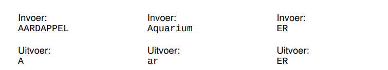

# Middelste letter(s)

Deze opgave komt uit NIO eerste ronde 2024-2025, opgave A1.

Schrijf een programma dat van standard input een regel met daarop een woord inleest.

Jouw programma schrijft naar standard output de middelste letter of twee letters van het woord in de invoer. Voor de middelste letter of letters en erna telt het woord evenveel letters.

## Invoer
Één lijn met één woord.

## Uitvoer
Één of twee letters.

## Voorbeelden

De woorden in de invoer bestaan uit minstens 2 en hoogstens 80 letters. Dat zijn alleen
hoofdletters (A..Z) en kleine letters (a..z), dus geen spaties, leestekens, cijfers, etc. en ook geen letters met accenten. De IJ als in BIJZONDER telt als twee letters.

Je moet de hoofd- en kleine letters van de invoer in stand houden in de uitvoer. Bij het eerste voorbeeld wordt ‘a’ dus niet goed gerekend!

Voor je programma geldt een tijdslimiet van 1 seconde
